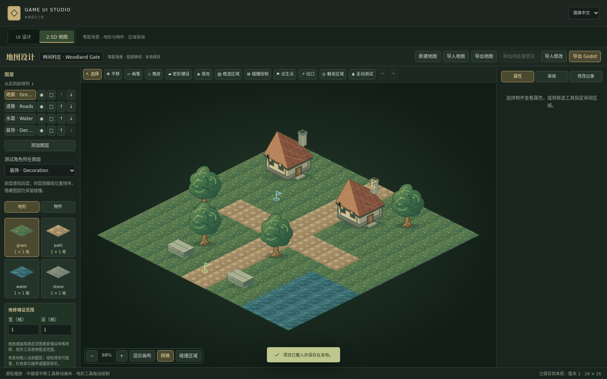

# 等距地图工作区

在顶部切换到 **2.5D 地图 / 2.5D map**。UI 和地图各有独立的文件与版本；切换工作区不会把 UI 转换为地图。两者共用本地服务、素材存储与中英文选择。

这一版制作的是二维素材组成的等距地图，支持可编辑地砖、物件、碰撞与局部审阅。不是三维地形、自由旋转镜头或多层高度编辑器。

## 从示例开始

点击 **新建地图 / New map** 可以选择名称与网格宽高，建立空白地图。操作会先下载旧地图 JSON 备份；已有 UI 不受影响。

首次打开会加载 `examples/village.map.json` 的村庄入口：16 × 16 格、64 × 32 等距地砖，含道路、水面、建筑、树木、围墙、出生点和出口。素材在 `public/assets/map/`，是本项目提供的 MIT 授权原创 SVG。

[查看八种原创素材预览](../previews/v0.2.0/map-assets.png)

1. 左侧选择图层，再选择地砖素材。使用 **画笔 / Brush**、**矩形铺设 / Rectangle**、**填充 / Fill** 或 **橡皮 / Erase** 编辑地形。
2. 使用 **物件 / Objects** 中的素材，再用 **放置物件 / Place object** 点击地图放置。使用 **选择 / Select** 拖动物件；坐标吸附到网格。属性面板可改显示尺寸、脚底锚点、占地尺寸与阻挡标记。
3. 图层可添加、隐藏和锁定。隐藏只影响显示，仍保留碰撞；锁定图层禁止编辑。误操作用撤销或重做恢复。
4. 滚轮缩放；中键或 **平移 / Pan** 移动画布；**适应画布 / Fit** 恢复全图视野。
5. 修改会保存到本机；检查“已保存到本机”状态后再关闭。保存冲突时先导出当前地图备份，再重新加载，避免丢失尚未保存的编辑。

地砖坐标、物件锚点和物件占地是不同数据。素材的默认占地使用整数格，例如树木 1×1、建筑 2×2；拖放时显示完整占地轮廓，落下后吸附到当前图层。超出地图或锁定图层的摆放会被拒绝。图片可以高过一格，阻挡区域仍由“占地宽度/高度”决定；占地从物件 `(x,y)` 向网格正方向延伸。图层按从后到前的顺序叠放，同层物件按照脚底深度排序；测试角色使用指定的角色图层。调整图层顺序和物件所属图层后，Godot 导出保留相同层级。

从素材面板直接拖拽地砖或物件到地图可进行拼接。地形的多格铺设范围会重复单格地砖；建筑等物件则保持一张素材、使用多格占地。像素显示尺寸与碰撞占地独立，不会因为房屋图片较高而多占一排格子。

## 导入自己的素材

点击 **导入素材 / Import asset**，选择 PNG、WebP、JPEG 或自包含 SVG，并指定用于地砖还是物件。地砖默认显示为当前网格尺寸。物件的显示尺寸和脚底锚点可单独调整。

如果素材是图集，启用 **图集裁切 / Atlas crop**，填写源图片中的像素坐标与宽高。当前操作一次定义一个裁切区域；它不是自动分割整套图集或自动匹配道路边缘的地形规则系统。原图字节仍保存在本机。

## 评论与 Codex 修改

1. **物件意见**：选择一棵树或房屋，再进入 **审阅 / Reviews**。评论绑定稳定物件 ID；物件移动后仍关联同一对象。
2. **区域意见**：选中目标图层，用 **框选区域 / Region** 拖出矩形，再添加评论。评论关联该图层和格子矩形。
3. 填写 **修改目标**、**期望效果**、**禁止修改** 和 **优先级**。例如：“拓宽村口道路”“保留水域通行标记”“不得替换树木素材”。
4. 点击 **导出待处理意见 / Export pending feedback**，同时 **导出地图 / Export map** 保存匹配版本的完整地图 JSON。给 Codex 的反馈包只含本轮待处理意见、局部截图、必要的物件/格子与素材，完整 JSON 用于真正校验补丁。
5. Codex 返回 `kind:"studio-map-patch"` 的补丁 JSON。在 **导入修改 / Import patch** 中先预览，检查修改前后值，选择要接受的修改。
6. 接受全部补丁后，意见变为“已修改”，最终通过由你决定。仅接受一部分时意见保持“待处理”；版本已经变化，下一轮需重新导出反馈。
7. **修改记录 / Changes** 中可回退已应用的补丁。回退只处理该补丁实际修改的字段；如果这些字段后来被改过，工具会拒绝覆盖并报告冲突。

给 Codex 的示例说明：

> 使用仓库中的 game-ui-studio skill。读取本轮地图反馈 ZIP 和同版本的完整地图 JSON，查看真实局部截图，只修改已评论物件或框选范围内的格子，遵守全部保护属性。运行 map.mjs validate 通过后返回地图补丁 JSON；不要重建整张地图，也不要修改稳定 ID 或自行批准意见。

配套技能与命令见 [.agents/skills/game-ui-studio/references/map-and-generation.md](../.agents/skills/game-ui-studio/references/map-and-generation.md)。新建 UI 的 Codex 任务包流程另见 [CODEX-GENERATION.md](CODEX-GENERATION.md)。地图补丁与 UI 补丁不可互换。

## 走动与 Godot

**碰撞绘制 / Collision** 设置不可通行格子；物件也可以勾选 **阻挡角色 / Blocks movement**。放置出生点、出口和触发标记后，开启 **走动测试 / Walk test**。点击可通行地面让测试角色沿网格路径移动，或用方向键移动。检查道路是否连通、建筑占地是否准确，以及角色经过物件前后时的遮挡。

这是基础网格走动验证。出口和触发点是可追踪的场景标记，游戏业务逻辑仍需在 Godot 项目中接入；不能把标记存在当成任务系统或场景切换已经完成。

点击 **导出 Godot / Export Godot** 得到独立项目 ZIP。目标版本为 **Godot 4.3 或更新版本**，使用 `TileMapLayer` 与二维物件。解压后打开 `project.godot`，运行测试场景，查看导出警告、节点映射和实际画面。以当前版本的运行测试报告为验收依据，不以 ZIP 下载成功代替引擎验证。

当前验证脚本是 `scripts/test-map-godot.js`；功能测试、引擎渲染与美术质量分别记录。示例美术用于检验流程，最终视觉质量仍需人工验收。

## 保存、备份和边界

- 本机地图文件是数据目录下的 `map.json`。源码默认在 `data/map.json`；Windows 安装版默认在 `%LOCALAPPDATA%\GameUIStudio\data\map.json`。UI 仍在同目录 `project.json`。
- **导出地图** 下载完整地图 JSON；**导入地图** 检查原生地图格式，下载旧地图 JSON 备份，再替换地图。素材文件不包含在 JSON 备份中，引用的素材必须存在于目标安装。
- 不要在编辑器运行时直接覆盖 `map.json`；使用导入功能或本地 API，让内存与磁盘保持一致。
- 当前支持最多 128 × 128 格、16 图层、2,000 物件；大量图片的实际性能还取决于素材大小与机器配置。
- 不包含 3D 模型、地形高度、动画制作、自动地形过渡、复杂关卡脚本、多人协作或云同步。
