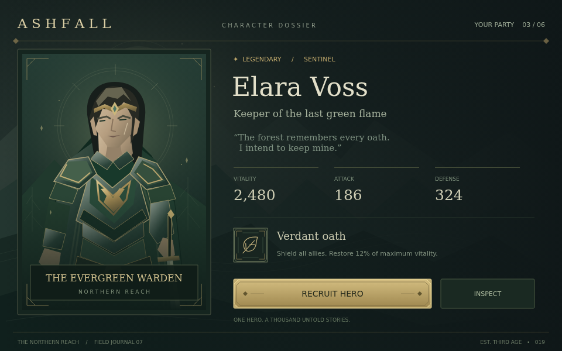

[v0.2.0 地图、占地拖放与吸附辅助线实测截图](v0.2.0/README.md)

# 已有图片恢复与预览

新版预览：[0.1.2 中文 / English 界面与导入窗口](v0.1.2/README.md) · [工具 Logo](branding/README.md)。以下为 2026-10-23 原始图片恢复记录。

检查日期：2026-10-23。找到 10 个独立 PNG 文件，以及 ZIP 内 20 个 PNG 成员（含重复副本）；合计 13 种唯一图片内容。现保存为 14 个有明确用途的 PNG 文件，其中 `editor/editor.png` 与 `editor/patch-diff.png` 字节相同。未发现本任务生成的 JPG / JPEG / WebP。

全部图片均通过文件头验证和完整像素解码。复制或从 ZIP 取出原始成员字节后，逐一验证字节及 SHA-256 完全一致。本次恢复没有调用图像生成工具，也没有重新截图、缩放、重编码或替换原图。

原始文件来自仓库 `artifacts/`（5 个）、`/tmp`（5 个），以及两个版本的反馈 ZIP（4 个独有局部截图）。可见任务记录中没有发现仅存在于图像生成工具返回值的图片。

## 直接预览

[编辑器初始界面](editor/initial.png) · [补丁审阅界面](editor/patch-diff.png) · [Godot 实际截图](godot/character-detail.png) · [角色插图](art/warden.png)

## 文件清单

下表文件均完整解码通过；来源的实际绝对路径、ZIP 成员名、重复副本及完整 SHA-256 见 [inventory.json](inventory.json)。ZIP 成员来源使用 `archive.zip!/member.png` 记法。

| 文件 | 用途 | 尺寸 | 原始字节数 |
| --- | --- | --- | ---: |
| [game/character-detail.png](game/character-detail.png) | 角色详情页初始画布 | 960×600 | 626,426 |
| [godot/character-detail.png](godot/character-detail.png) | Godot 实际运行截图 | 960×600 | 182,926 |
| [godot/difference-x4.png](godot/difference-x4.png) | 画布与 Godot 差异增强图（原有 ×4） | 960×600 | 294,548 |
| [editor/editor.png](editor/editor.png) | 编辑器补丁审阅界面 | 1600×1000 | 492,255 |
| [editor/patch-diff.png](editor/patch-diff.png) | 补丁差异截图（与 editor.png 字节相同） | 1600×1000 | 492,255 |
| [editor/initial.png](editor/initial.png) | 初始编辑器与待处理意见 | 1600×1000 | 508,934 |
| [art/warden.png](art/warden.png) | 角色 SVG 的已有栅格预览 | 628×876 | 328,217 |
| [diagnostics/browser-runtime.png](diagnostics/browser-runtime.png) | 浏览器运行诊断截图 | 1280×720 | 5,534 |
| [diagnostics/godot-layout.png](diagnostics/godot-layout.png) | Godot 容器布局诊断截图 | 640×360 | 5,902 |
| [diagnostics/godot-runtime.png](diagnostics/godot-runtime.png) | Godot 运行诊断截图 | 640×360 | 8,214 |
| [feedback/revision-9/recruit-button.png](feedback/revision-9/recruit-button.png) | revision 9 招募按钮反馈截图 | 370×82 | 17,218 |
| [feedback/revision-9/character-card.png](feedback/revision-9/character-card.png) | revision 9 角色卡反馈截图 | 362×486 | 201,193 |
| [feedback/revision-1/recruit-button.png](feedback/revision-1/recruit-button.png) | revision 1 招募按钮反馈截图 | 370×82 | 17,442 |
| [feedback/revision-1/character-card.png](feedback/revision-1/character-card.png) | revision 1 角色卡反馈截图 | 362×486 | 202,385 |

`diagnostics/` 保留早期运行和布局验证的真实截图，仅用于诊断。`feedback/revision-1/` 与 `feedback/revision-9/` 来自不同文档状态，不能互换作为同一修改前后的证据。`godot/difference-x4.png` 是此前已生成的差异增强图。美术质量仍按 [独立美术验收](../docs/ART-REVIEW.md) 评审。

## 检查范围与限制

- 扫描 `/workspace`、`/tmp`，跳过 Git 内部文件、依赖目录和 Python 缓存。检查 8 个外层 ZIP 和 2 个嵌套反馈 ZIP；两份项目交付 ZIP 未包含额外独有截图。
- `/tmp/game-ui-research/` 中 424 个上游 Penpot 文档/图标文件不属于本任务生成的图片，未复制进预览目录。
- `/tmp/codex-daemon-1000` 为不可读的平台目录，无法核查其内容；现有任务记录没有指向该目录的图片产物。
- `previews/` 未被 `.gitignore` 排除。仅提取当前 Ashfall 示例的局部截图，`data/` 工作数据与原始导出 ZIP 未加入 Git。
- 云环境能够读取和解码这些图片，但无法确认聊天客户端的内嵌显示是否成功，也无法在此确定客户端显示故障的根因。GitHub 可直接打开本目录及各 PNG 文件。

现有 v0.1.0 标签和发行 ZIP 保持原样；本次补充的完整预览在 `main` 分支的 `previews/`。
