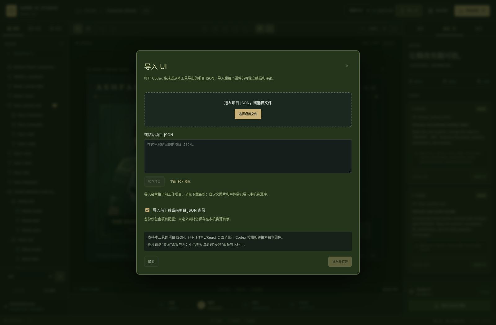

# 0.1.2 编辑器截图

这些截图来自真实 Chromium 中运行的生产版编辑器；导入、编辑、保存和语言切换已实际操作验证。项目和测试数据使用独立临时目录。

| 预览 | 文件 |
| --- | --- |
| 中文界面，顶部“导入 UI”和右上语言选择 | [editor-zh.png](editor-zh.png) |
| 英文界面 | [editor-en.png](editor-en.png) |
| 中文导入窗口 | [import-zh.png](import-zh.png) |
| 英文导入窗口 | [import-en.png](import-en.png) |

[操作说明](../../docs/IMPORT-AND-LANGUAGE.md) · [浏览器测试报告](../../artifacts/v0.1.2/import-language-results.json)
