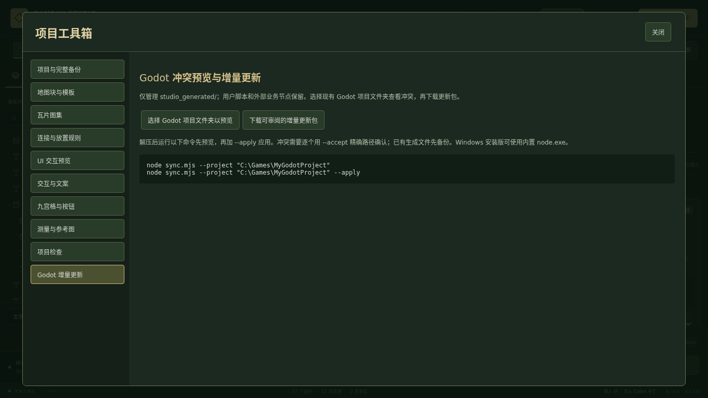

# v0.3.0 实际界面与运行截图

这些截图来自真实浏览器操作和 Godot 引擎，不是静态原型替代品。

- [项目库与多页面](projects-en.png)
- [可点击 UI、文案与多分辨率](ui-preview-en.png)
- [九宫格拖动与按钮状态](nine-slice-en.png)
- [地图块整体拖放](map-block-drag-en.png)
- [瓦片图集切分](atlas-en.png)
- [地图测量](map-measure-en.png)
- [项目检查](checks-en.png)
- [Godot 增量更新](godot-update-en.png)
- [中文工具箱](toolbox-zh.png)
- [Godot 更新前](../../artifacts/v0.3.0/godot-update/before.png)
- [Godot 更新后](../../artifacts/v0.3.0/godot-update/after.png)
- [Godot 实际地图](../../artifacts/v0.3.0/godot-update/map.png)

[使用说明](../../docs/PROJECT-TOOLBOX.md) · [测试与限制](../../docs/VALIDATION-v0.3.0.md)

截图展示功能工作流；最终游戏美术仍需独立人工验收。旧版预览和原始素材未替换。
