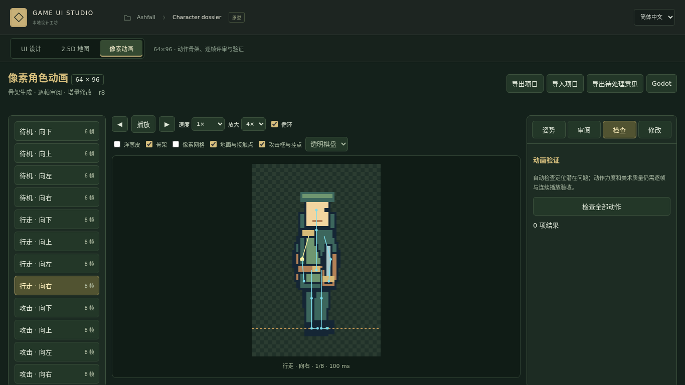

# v0.4.0 像素动画实际截图

以下图片来自真实工作区操作和 Godot 运行。

- [动画编辑器](animation-editor-en.png)
- [中文界面](animation-editor-zh.png)
- [洋葱皮与播放](animation-onion-en.png)
- [攻击框与挂点](animation-attack-en.png)
- [逐帧评审](animation-review-en.png)
- [增量补丁差异](animation-patch-en.png)
- [Godot 实际运行](../../artifacts/v0.4.0/animation-godot/animation.png)

默认角色画布64×96；示例美术是程序绘制的动作参考，尚未作为最终游戏美术验收。

[使用说明](../../docs/PIXEL-ANIMATION.md) · [测试报告](../../docs/VALIDATION-v0.4.0.md)
