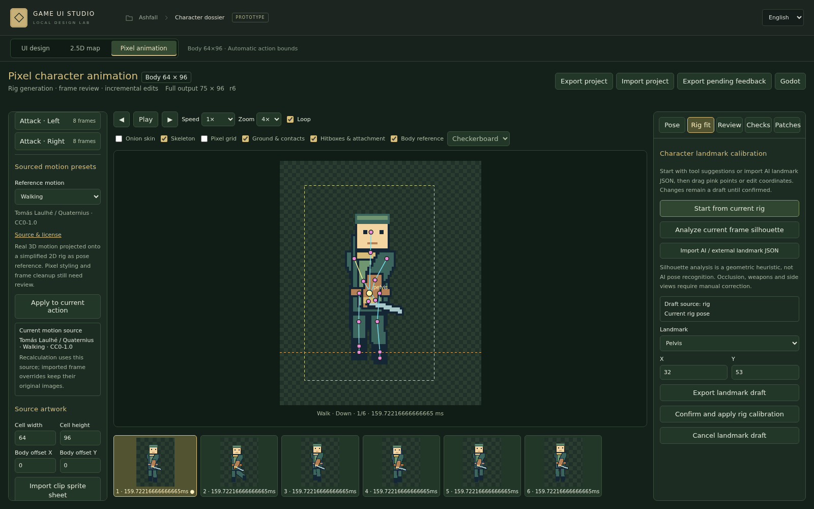

# v0.4.1 实际工作区截图

64×96是主体参考框，动作和武器允许超出。以下为真实浏览器与Godot运行截图。

- [完整攻击动作与主体参考框](animation-attack-en.png)
- [真实来源动作库](animation-motion-reference-en.png)
- [角色关节标定与人工修正](animation-rig-draft-en.png)
- [中文工作区](animation-editor-zh.png)
- [逐帧意见](animation-review-en.png)
- [Godot来源动作运行](../../artifacts/v0.4.1/animation-godot/animation.png)
- [Godot超出主体范围的攻击测试](../../artifacts/v0.4.1/animation-godot/attack-outside-body.png)

`animation-rig-calibration-en.png` 使用合成导入图专门验证确认与像素保留，不作为最终角色美术展示。示例美术独立验收。

[操作说明](../../docs/PIXEL-ANIMATION.md) · [测试记录](../../docs/VALIDATION-v0.4.1.md)
